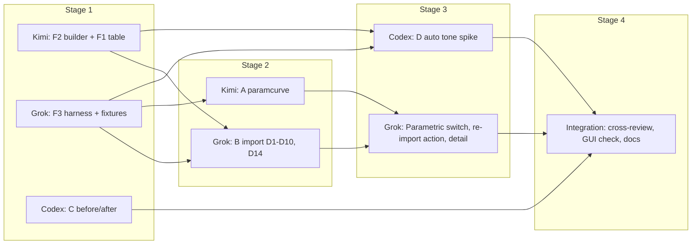

# Architecture: Lightroom workflow layer (v1, approved)

Status: **v1, approved by the owner 2026-10-10**. Produced by the orchestrating
agent from draft v0 plus two review rounds by Kimi (darktable internals),
Grok Builder (Lightroom semantics and coverage) and Codex (engineering
architecture and testing). This document is the contract freeze ("stage 0").
Stage 1 has started. Changing a frozen interface later requires updating
this file first.

Review record (all in `.local-logs/`, git-ignored): drafts and prompts
`review-*-*.prompt.md`; round 1 reports `review-r1-{kimi,grok,codex}.final.md`;
round 2 cross-discussion `review-r2-{kimi,grok,codex}.final.md`.

Facts cite `file:line` at `feature/lightroom-workflow` (code unchanged since
`ef3a70c5b`). Companion: `ROADMAP-lightroom-workflow.md`.

---

## 1. Goals and non-goals

**Lightroom is the standard.** When a legacy darktable mapping and a
Lightroom control disagree, follow Lightroom: the same panel, the same
slider meaning, and the module that panel actually shows. That is why HSL
lands on `colorequal` rather than `colorzones`, Clarity on
`contrastntexture` rather than `bilat`, and color grade on
`colorbalancergb` 4-ways rather than split toning. Pixel identity with
Adobe's proprietary process is not required. Scales Lightroom does not
publish (parametric peak height, HSL hue degrees) start from the structural
conversion in the decision log and are calibrated with F3.

Exposure is the one place this is easy to misread. Lightroom's Exposure 0
means "no extra exposure on top of the developer's working baseline."
darktable's scene-referred baseline is +0.7 EV, so the imported value is
added to that default (D1). Replacing the default would make Exposure 0
darker than both Lightroom's and darktable's normal starting point.

1. **B: Lightroom XMP import** that makes the owner's photo-flavor sidecars
   (`IMG.xmp` next to `IMG.ARW`, crs: namespace, Process Version 15.4)
   render in darktable on the modules of "workflow: lightroom".
2. **A: parametric tone curve** (`paramcurve`) with Lightroom semantics.
3. **C: before/after** on `\` in the darkroom.
4. **D: Auto tone**, as a research spike.
5. **M: Lightroom-style masks**, a panel over the mask engine that already
   exists. Section 9. Subject and sky masks stay out.

Non-goals: Lightroom XMP export; AI subject/sky masks; importing Lightroom
mask groups from XMP; changing any existing module's `params_t` or version;
changing `dt_develop_blend_params_t`; database schema changes; new
dependencies.

---

## 2. Facts that shaped v1 (verified, several corrected from v0)

- **Module rows are imported only on the darkroom path.** Every module
  branch in `src/develop/lightroom.c` is gated on `dev != NULL`
  (`lightroom.c:1312, 1322, 1388, 1397, 1404, 1413, 1449, 1536, 1549, 1558`).
  The library-import call with `dev == NULL` (`common/image.c:2072-2075`)
  imports only rating, labels, tags, GPS, metadata (`lightroom.c:1575-1607`).
  Module rows are written at the first darkroom open via
  `dt_dev_read_history_ext` (`develop/develop.c:2532-2533`), right after
  `_dt_dev_load_pipeline_defaults(dev)` (`develop.c:2509`), so
  `module->default_params` already holds image- and workflow-dependent
  defaults (e.g. exposure +0.7 EV, `iop/exposure.c:357-363`). (v0 was wrong.)
- **The import is one-shot.** It runs on `first_run`, which is tied to
  `DT_IMAGE_AUTO_PRESETS_APPLIED`; afterwards it never runs again.
- **Auto-applied workflow presets are prepended** (`develop.c:2408-2415`); an
  imported row lands after them, and for equal `multi_priority` the later row
  wins for that instance (`develop.c:2669-2670`).
- **The owner's sidecars are photo-flavor presets**: `DSC04299.xmp`,
  `DSC04300.xmp`, `DSC04302.xmp` ("Moody Teal-Orange Matte Base",
  ProcessVersion 15.4). They set: Temperature 5600-5700 with
  `WhiteBalance="Custom"` and Tint 3; Exposure 0..+0.2; Contrast -5..-2;
  Highlights, Shadows, Whites, Blacks (+10..+15); Texture 0; Clarity -5;
  Dehaze -5; Vibrance +15; Saturation -2; ColorGrade shadow hue 210 / sat
  15, midtone 35 / 10, highlight 40 / 15, blending 40; identical
  SplitToning values; HSL adjustments; Sharpness 25 etc.; LuminanceSmoothing
  15, ColorNoiseReduction 25; Parametric* all identity. (Grok, r1-8.)
- **photo-flavor's Temperature is a relative shift**, stored as
  `round(5500 + shift/100*2000)` (`~/photo-flavor/photo_flavor/xmp.py:32-33`,
  `preset.py:33-37`), not the scene's Kelvin.
- **Existing importer targets are wrong for this workflow**: Exposure +
  Blacks go into one legacy v2 exposure blob that also turns off
  `compensate_exposure_bias` (`lightroom.c:518-534`, `exposure.c:196-199`);
  `lr2dt_blacks` sends +100 to -0.010 (`lightroom.c:277-282`); Clarity goes
  to `bilat` (`lightroom.c:794-801`), which the Lightroom preset does not
  show; HSL goes to `colorzones`; **split-toning hue is divided by 255 while
  the field is a 0..1 fraction of 360 degrees** (`lightroom.c:769`,
  `iop/splittoning.c:46`, factor 360 at :491), so hue 210 renders near 297
  degrees (an upstream bug).
- **Its parametric-to-tonecurve conversion is not Lightroom's curve**: it
  multiplies a midpoint node by `1 + slider/100` (`lightroom.c:1492-1528`).
- **Pipeline colorspaces after the tone mappers**: `sigmoid` 45.3, `agx`
  45.5, `filmicrgb` 46.0 and `spektrafilm` 46.7 are RGB; `colisa` 47.0,
  `tonecurve` 48.0 and `levels` 49.0 are Lab (`colisa.c:103-107`,
  `tonecurve.c:175-179`, `levels.c:130-134`). The only display-referred RGB
  slot is between 46.7 and 47.0, in all five order tables
  (`iop_order.c:150-151, 268-270, 391-393, 515-517, 641-643`).
- **New modules need**: an entry in all five order tables
  (`legacy_order` :81, `v30_order` :183, `v50_order` :306, `v30_jpg_order`
  :430, `v50_jpg_order` :556) plus `dt_ioppr_migrate_legacy_iop_order_list()`
  (`iop_order.c:744-770`), `src/iop/CMakeLists.txt`, and two
  `po/POTFILES.in` lines (reference commit `1067c653c`, contrastntexture).
  No `process_cl` is allowed (`pixelpipe_hb.c:2535-2536`).
- **darktable-mcp works as the test base**: Codex measured init 14.7 s, then
  `image_stats` 0.18-0.22 s per call on `DSC04309.ARW` (scratch path input).
- **Snapshots are not a side-effect-free "original" view**: creating one
  calls `dt_dev_write_history` (`libs/snapshots.c:923`) and restore rewrites
  history (`snapshots.c:1044-1069`); the render primitive
  `dt_dev_image(..., history_end, ..., snapshot_id, ...)`
  (`develop.c:4307-4340`) renders a detached image at any history position.
- **AgX contrast lives in a named section** (`agx/curve/contrast`,
  `agx.c:1819,1844`); AgX white/black relative exposure are on an unnamed
  section (`agx/white relative exposure`, `agx.c:2487`).

---

## 3. Decision log

Each decision records the reviewers' positions and the reason.

| # | Topic | Decision | Positions and reason |
|---|---|---|---|
| D1 | Exposure2012 | `exposure.exposure = default + LR EV` (seeded default), one row | all three agree after r2: replacing the +0.7 EV default makes LR exposure 0 render darker than darktable's default |
| D2 | Contrast2012 | follow the workflow, like the QAP: sigmoid `middle_grey_contrast = default + 0.5 * x/100`; filmic `filmicrgb.contrast` (scale to calibrate); AgX `agx` curve contrast field; otherwise `colorbalancergb.contrast` | Kimi r1 proposed colorbalancergb always, withdrew in r2; importing into colorbalancergb would leave the visible sigmoid Contrast slider unchanged and stack two contrasts |
| D3 | Whites2012, Blacks2012 | tone-mapper targets, workflow-masked: sigmoid `display_white_target` / `display_black_target` as deltas around their defaults (sign and gain calibrated with F3); filmic `white_point_source` / `black_point_source`; AgX `range_white_relative_ev` / `range_black_relative_ev`; nothing for spektrafilm / none. No more `exposure.black` writes | Kimi r1 "keep exposure black", withdrew in r2 (the old write is 1% of range and a different control) |
| D4 | Highlights2012, Shadows2012 | `toneequal.highlights` and `toneequal.deep_blacks` (the bands labeled "highlights" and "shadows", `toneequal.c:177,181`) = x/100, so ±100 starts at ±1 EV inside the ±2 EV hard range. F3 calibrates. Texture and Clarity stay on `contrastntexture` | Owner, 2026-10-10: highlights and shadows on the tone equalizer; whites and blacks stay on the tone mapper. The quick-access panel shows `toneequal/highlights` and `toneequal/shadows` |
| D5 | Texture, Clarity2012 | `contrastntexture.gain_medium` / `gain_coarse` = x/100; no `bilat` row | Kimi + Grok vs Codex r1 ("keep bilat until measured"); decided for contrastntexture because `bilat` is invisible in the Lightroom preset; F3 calibrates the scale |
| D6 | Dehaze | `hazeremoval.strength` = x/100; write the module only when the tag is non-zero | default strength is 0.2 (`hazeremoval.c:66`), so writing 0 would change the image |
| D7 | Vibrance, Saturation | `colorbalancergb.vibrance` / `saturation_global` = x/100, in the same blob as D8 | unanimous |
| D8 | ColorGrade* | `colorbalancergb` 4-ways in B: shadows/midtones/highlights/global hue in degrees unchanged, sat and lum /100 (lum is -100..+100); one colorbalancergb blob together with D7; do not emit `splittoning` for these files | Grok r1 (colour grade is the owner's look); not imported today; suppressing split toning also avoids the /255 hue bug |
| D9 | HSL (Hue/Saturation/LuminanceAdjustment*) | target `colorequal` (sat and brightness `1 + x/100`; hue starts at `0.3 * x` degrees, calibrate with F3; Lightroom Aqua = cyan, Purple = lavender) instead of `colorzones` | **approved 2026-10-10**. The owner: Lightroom is the standard, so the eight named HSL sliders win over the colorzones spline and its 3/9 and 4/9 fudge factors (`lightroom.c:487-488`). Own commit, because it changes every Lightroom import |
| D10 | Temperature, Tint, WhiteBalance | photo-flavor contract: `WhiteBalance="As Shot"` or shift 0 means no change; otherwise add `(Temperature - 5500)` K to the as-shot CCT that color calibration recovers in `reload_defaults` (`channelmixerrgb.c:3884-3891`), apply tint as a small offset, convert to the illuminant chromaticity and write channelmixerrgb's illuminant fields; the `temperature` module stays at camera reference (avoids the double-CAT warning, `channelmixerrgb.c:2053-2068`) | Grok r1/r2, Kimi r2 agree; it may slip to stage 3 without blocking the rest of B |
| D11 | Parametric* | new `paramcurve` module (A); B maps the seven tags to it in stage 3 and stops generating `tonecurve` nodes for them; until then all-zero sliders already emit nothing (`lightroom.c:1468-1470`) | unanimous |
| D12 | paramcurve placement | iop order **46.8** (after spektrafilm 46.7, before colisa 47.0) in all five tables, plus the migrate hook inserting it before `colisa` | Kimi r1, adopted by Grok and Codex in r2; v0's 48.5 sits among Lab modules |
| D13 | paramcurve semantics | input tone 0..1, display-referred RGB; splits (default 25/50/75 %, kept strictly ordered with a minimum gap) cut [0,1] into Shadows/Darks/Lights/Highlights; a region slider adds a bump supported only inside its region, zero and flat at both edges (e.g. `sin(pi t)^2`), peak at the middle; black and white fixed; always monotonic; peak height at +/-100 calibrated with F3, not guessed; applied through a luminance ratio to keep hues; values outside [0,1] pass through | Grok r1-7 and Q5 |
| D14 | History write policy (B) | darkroom path only; for each target op build ONE blob seeded from `module->default_params`, apply all of that op's tags, append one row at `multi_priority` 0 with the module's current version (`so->version()`) and its current default blend params; skip an op when all its tags are zero; never create a second instance; suppress the legacy rows (exposure-black, bilat, colorzones, splittoning) for tags handled by the new paths | consensus of r2; replaces hard-coded `LRDT_*` versions and the legacy v4 blend blob (`lightroom.c:331, 358-359`) for the new rows |
| D15 | Re-import | needed because the import is one-shot. Stage 2: a test path (F3 fixtures are fresh copies, so they always import). Stage 3: a user-facing "re-import Lightroom sidecar" action. Until B lands, **do not open `DSC04299` or `DSC04300` in the darkroom** (their sidecars still have `auto_presets_applied="0"`, so the current, wrong importer would run once and consume the import) | Grok r1-6; deleting history is the wrong tool (it also re-applies presets) |
| D16 | F2 API | explicit defaults pointer, no `imgid` (section 4) | unanimous after r2 |
| D17 | F1 shape | grouped field writes, add-to-default flag, workflow mask passed by the caller, QAP id kept separately, no inverse until export exists; HSL and colour-grade rows in the table; white balance and the parametric switch stay as code in the importer | Codex r1-2 + Grok r1-2 + Kimi trims |
| D18 | Before/after mechanism | **Owner, 2026-10-10: original is the normal starting picture**, the one darktable shows on first open, before any slider moves. Transient render, no snapshot, no history write, main window only. That picture keeps the exposure module and the tone mapper on. It is not `history_end = 0`. Codex's `6b6fb6a36` implements the empty-history version and stays off this branch. The starting exposure is two separate +0.7 EV effects: the scene-referred slider default (`exposure.c:360`) and "compensate exposure bias", which undoes the camera tag. These files record `ExposureBiasValue` **-0.7 EV** (`DSC04299`, `DSC04300`, `DSC04302`, `DSC04309`), so compensation brightens by 0.7 on top of the slider | Owner confirmed the before view. The camera tag and the slider default are different numbers that happen to share a magnitude |
| D19 | Auto tone | research spike after F2/F3; existing "auto" pieces are picker callbacks (`agx.c:1135`, `exposure.c:51-52` is deflicker) | unanimous |
| D20 | Stage 0 | this document is the freeze; no extra agent stage | Grok r2; Kimi and Codex asked for a freeze, which the review rounds produced |
| D21 | Owners | F3 to Grok, C to Codex in stage 1 | Grok and Kimi recommended; Codex r2's table also gives F3 to Grok |
| D22 | Detail (sharpening, noise reduction) | stage 3, after checking whether `denoiseprofile` is auto-applied for the camera (a second instance would stack) | Grok |
| D23 | Release notes, translations | integration stage: new strings via `_()` / `NC_`, `po/POTFILES.in`; a `RELEASE_NOTES.md` entry only if something goes upstream (this is a single-owner fork) | Codex r1-8, Kimi r2 nuance |
| D24 | "never create a branch" (Codex r1-7) | dismissed: that rule belongs to Codex's own environment; the owner approved one branch and worktree per task | orchestrator |

---

## 4. Frozen interfaces

### F2: params builder (`src/develop/iop_params.h`, libdarktable)

JSON-free core extracted from `_seed_and_apply` in `src/mcp/dt_bridge.c`
(:477-570); the MCP bridge keeps its JSON parsing and calls the core.

```c
typedef struct dt_iop_params_builder_t dt_iop_params_builder_t;

typedef enum dt_iop_params_err_t
{
  DT_IOP_PARAMS_OK = 0,
  DT_IOP_PARAMS_NO_MODULE,         // unknown op
  DT_IOP_PARAMS_NO_INTROSPECTION,  // module has no introspection
  DT_IOP_PARAMS_SIZE_MISMATCH,     // defaults size != introspection size
  DT_IOP_PARAMS_NO_FIELD,          // unknown field name
  DT_IOP_PARAMS_TYPE,              // field is not a scalar of that type
  DT_IOP_PARAMS_RANGE,             // value outside the field's hard range
} dt_iop_params_err_t;

// defaults: caller-owned copy source (e.g. module->default_params); it is
// copied, so the caller may free it afterwards. NULL means "synthesize from
// $DEFAULT", refused for modules with non-scalar fields (dt_bridge.c:493-503)
dt_iop_params_builder_t *dt_iop_params_builder_new(const char *op,
                                                   const void *defaults,
                                                   size_t defaults_size,
                                                   dt_iop_params_err_t *err);
dt_iop_params_err_t dt_iop_params_builder_set_float(dt_iop_params_builder_t *b,
                                                    const char *field, float v);
dt_iop_params_err_t dt_iop_params_builder_set_int(dt_iop_params_builder_t *b,
                                                  const char *field, int v);
dt_iop_params_err_t dt_iop_params_builder_get_float(const dt_iop_params_builder_t *b,
                                                    const char *field, float *v);
// blob stays owned by the builder until _free; version is so->version()
const void *dt_iop_params_builder_blob(const dt_iop_params_builder_t *b,
                                       size_t *size, int *version);
void dt_iop_params_builder_free(dt_iop_params_builder_t *b);
const char *dt_iop_params_err_str(dt_iop_params_err_t err);
```

"Add to default" is done by the caller: `get_float`, add, `set_float`.
Thread safety: a builder is used by one thread; the API keeps no globals.
The MCP bridge's existing tests (`dt_bridge.c:659-661` seam) must stay green.

### F1: Lightroom mapping table (`src/develop/lightroom_map.h`)

```c
typedef enum dt_lr_workflow_t
{
  DT_LR_WF_SIGMOID = 1 << 0,
  DT_LR_WF_FILMIC  = 1 << 1,
  DT_LR_WF_AGX     = 1 << 2,
  DT_LR_WF_OTHER   = 1 << 3,  // spektrafilm, display-referred, none
  DT_LR_WF_ALL     = 0xf,
} dt_lr_workflow_t;

typedef enum dt_lr_flags_t
{
  DT_LR_ADD_TO_DEFAULT = 1 << 0,  // new value = module default + converted value
  DT_LR_SKIP_IF_ZERO   = 1 << 1,  // a zero LR value contributes nothing
} dt_lr_flags_t;

typedef struct dt_lr_mapping_t
{
  const char *crs_tag;           // e.g. "Highlights2012"
  const char *op;                // e.g. "contrastntexture"
  const char *field;             // introspection field, e.g. "gain_highlights"
  float (*convert)(float lr);    // LR value -> darktable value (before ADD_TO_DEFAULT)
  uint32_t flags;                // dt_lr_flags_t
  uint32_t workflows;            // dt_lr_workflow_t mask
} dt_lr_mapping_t;

// all rows whose crs_tag matches and whose mask contains wf (several rows
// per tag are allowed: one tag can write several fields)
size_t dt_lr_map_lookup(const char *crs_tag, dt_lr_workflow_t wf,
                        const dt_lr_mapping_t **rows, size_t max_rows);
dt_lr_workflow_t dt_lr_workflow_from_conf(const char *workflow_conf_value);
```

QAP ids are not stored here (they are labels, not field names; see
`modulegroups.c:2119-2144` vs `contrastntexture.c:78-85`). Rows for D1-D9
are filled in this table; white balance (D10) and the parametric switch
(D11) are code in `lightroom.c`. All field names must be checked against
the module sources when the rows are written (e.g. sigmoid
`middle_grey_contrast`, `display_white_target`, `display_black_target` at
`sigmoid.c:59-62`; colorbalancergb 4-ways fields at `colorbalancergb.c:63-74`;
colorequal bands at `colorequal.c:118-143`).

### F3: verification harness (`tools/lr-harness/`, fork-only)

```
dtmcp.py tools                                   # list server tools
dtmcp.py schema  --op OP
dtmcp.py stats   --raw FILE [--stack S.json] [--width 512] [--no-tonemapper] [--json]
dtmcp.py render  --raw FILE [--stack S.json] --out OUT.png
dtmcp.py compare --raw FILE --stack A.json --stack B.json [--json]   # per-channel deltas
dtmcp.py history --raw FILE                      # needs FILE's basename.xmp beside it; runs the
                                                 # first-open import on a scratch copy and dumps
                                                 # the resulting history (op, version, decoded fields)
fixtures.sh                                      # copies fixtures to /tmp/lr-fixtures/
```

Rules: always scratch `input.path` renders; throwaway `--configdir`
(`/tmp/lr-harness/cfg`) and cache; startup timeout 90 s; JSON output for
machine checks. Fixtures: copies of `DSC04299/04300/04302.ARW` with their
`DSC0*.xmp` only (never the `.ARW.xmp`), plus one photo-flavor sample with
non-zero contrast/texture/dehaze/grade luminance, plus a sidecar with
identity parametric (regression). The "no change" baseline is darktable's
workflow-default render (exposure +0.7 EV), not a flat render.

How `history` triggers the darkroom-path import headless must be designed by
the F3 owner (options: darktable-mcp render of a fresh import, which runs
`dt_dev_read_history_ext`; or darktable-cli export of a fresh copy) and
documented in `tools/lr-harness/README.md`.

### A: `paramcurve` contract

op `paramcurve`, UI "parametric curve", params v1 (padding-free):
`float shadows, darks, lights, highlights` (-1..1, default 0) and
`float split_shadows, split_midtones, split_highlights` (0.05..0.95,
defaults 0.25 / 0.5 / 0.75), order 46.8, disabled by default, semantics D13.
QAP: `paramcurve/highlights`, `/lights`, `/darks`, `/shadows` under `@tone
curve` before `rgbcurve/channel`; module in the "tone curve" tab.

### C: before/after contract

Darkroom action "show original" (translatable), default shortcut `\`;
toggles a transient render of the picture as it first opens (D18); toast while
active; ends on image change or view change; writes nothing to history, the
database or the sidecar. Not implemented on this branch yet.

---

## 5. Stages, owners and file ownership



| Stage | Agent | Task | Owns (only writer in that stage) | Depends on |
|---|---|---|---|---|
| 1 | Kimi | F2 builder (+ bridge refactor), F1 table with rows D1-D9 | `src/develop/iop_params.{c,h}`, `src/develop/lightroom_map.{c,h}`, `src/CMakeLists.txt`, `src/mcp/dt_bridge.c` | - |
| 1 | Grok | F3 harness, fixtures, metric definitions | `tools/lr-harness/*` | darktable-mcp |
| 1 | Codex | C before/after | `src/views/darkroom.c` (and `src/develop/develop.{c,h}` only if a hook is unavoidable; report it) | - |
| 2 | Grok | B import: D1-D10 (D9 approved, own commit), D14, suppression of legacy rows, F1 row additions | `src/develop/lightroom.c`, `src/develop/lightroom_map.c` | F1, F2, F3 |
| 2 | Kimi | A paramcurve module + QAP entries | `src/iop/paramcurve.c`, `src/iop/CMakeLists.txt`, `src/common/iop_order.c`, `src/libs/modulegroups.c`, `po/POTFILES.in` | F3 |
| 3 | Grok | Parametric switch to paramcurve; user-facing re-import action; detail (sharpen, noise reduction) | `src/develop/lightroom.c`, `lightroom_map.c`, plus the re-import action's file (named in its design) | A, B |
| 3 | Codex | D auto tone spike (design or prototype) | darkroom view (after C is merged) | F2, F3 |
| 4 | orchestrator (+ Codex test matrix) | cross-reviews, GUI check, roadmap, docs | docs | all |

Every task: own worktree, branch and build dir; cross-review by another
agent before the orchestrator's review; the orchestrator cherry-picks onto
`feature/lightroom-workflow` below the docs commit.

---

## 6. Acceptance criteria and verification

| Task | Acceptance | Verification |
|---|---|---|
| F2 | builds; MCP `encode_params` returns identical blobs before/after the refactor for a set of ops; errors for unknown op/field/type/range | MCP test seam; a before/after comparison script on `encode_params` output |
| F1 | builds; every row's `op`/`field` resolves through introspection; lookups return all rows for multi-field tags | a small self-check (run under F3) that resolves every row |
| F3 | all commands work on fixtures; scratch only (fixture dirs unchanged, no sidecars written); `stats` repeatable to the decimal; JSON output | run each command twice; diff outputs; `find /tmp/lr-fixtures -newer` |
| C | `\` toggles the workflow-default render and the edit; the default still has exposure +0.7 EV and the tone mapper; history, `images.history_end` and the sidecar unchanged; toast; ends on image change | GUI check by the orchestrator; DB/sidecar checksums before and after |
| B | on each fixture: exposure = default + sidecar EV; contrast/whites/blacks on the workflow tone mapper; highlights and shadows on `toneequal` (`highlights`, `deep_blacks`); texture and clarity on `contrastntexture`; hazeremoval only if Dehaze != 0; colorbalancergb (vibrance, saturation, 4-ways with hue 210 kept as 210 degrees); no splittoning, colorzones, bilat or exposure-black rows for those tags; one row per op; current versions; a second open adds no rows; stats move in the expected directions (highlights -20 lowers the bright region, shadows +20 raises the dark region) | `dtmcp.py history` + `stats`/`compare` on fixtures; then a GUI look by the orchestrator |
| A | LUT: identity at all-zero; region locality; monotonic for all 3^4 combinations of {-1,0,1} and random splits; module at 46.8 in every order table and after migration; sliders shift stats in the right region; off by default changes no existing render | unit check program; `dtmcp.py stats` with stacks; `get_history` iop_order; regression render of the A1 II samples |
| D | a written design, or a prototype that sets the Basic controls from image stats and is measured with F3 | review |

Regression gate for every merge: the Phase 0 sample exports (roadmap 7.4)
stay pixel-identical, and the existing "workflow: lightroom" QAP still
renders as verified in roadmap 9.5/10.5.

---

## 7. Effort (reviewers' estimates)

F2 ~8 h, F1 ~4 h (Kimi); F3 6-10 h (Codex/Grok estimates); B ~24 h (Grok);
A 16-24 h (Kimi); C 6-12 h (Codex); parametric switch ~4 h; detail ~10 h;
D: spike.

---

## 8. Owner decisions (2026-10-10)

1. v1 is approved. Stage 1 is in progress.
2. D9 is approved: HSL targets `colorequal`, in its own commit.
3. Design rule, stated by the owner: treat Lightroom as the standard and
   keep the design as close to Lightroom as possible. See section 1.
4. Until a re-import action exists, keep `DSC04299` and `DSC04300` closed
   in the darkroom. B has landed, so the first open would consume the import.
5. Masks are in scope (section 9). The owner asked for them on top of the
   existing mask engine, and for that design to be finished before the next
   stage is executed.

---

## 9. Lightroom-style masks (revised 2026-10-11 after two review rounds)

Kimi, Grok, and Codex reviewed this section twice. v1 below is what they
agreed. Round-1 and round-2 notes are in `.local-logs/mask-r{1,2}-*.report.md`.
Nothing in the blend pipeline is rewritten.

### 9.1 What a local adjustment is

One named mask, owned by one `localmask` instance, plus the local sliders.
The brush, ellipse, linear gradient, group combine, feather, and opacity
stay the engine in `masks.h` and `blend.h`.

`localmask` copies pixels through unchanged. It has
`IOP_FLAGS_SUPPORTS_BLENDING`, it is not `IOP_FLAGS_ONE_INSTANCE`, and it is
not itself in raster mode (`imageop.c` will not advertise a raster from a
raster-mode module). `default_enabled` is FALSE, so a photo with no local
adjustment does not grow one. `hide_enable_button` is TRUE. Do not set both
`default_enabled` and `hide_enable_button`: that pair forces the module on
for every image. No `process_cl` in v1 (the fork rule). A copy-only OpenCL
path is a later exception; without it an OpenCL pipe drops to CPU at this
module.

The source stays enabled for the life of the group. Turning it off deletes
the stored raster and every local slider becomes a no-op
(`pixelpipe_hb.c` around the disabled-source check). Delete the adjustment
to remove it. There is no power button for it in the Lightroom panel.

Shapes and the empty state:

- No shapes yet, or the last shape was just deleted: the instance is
  enabled, and `mask_mode` does not include `DEVELOP_MASK_MASK`,
  `DEVELOP_MASK_CONDITIONAL`, or `DEVELOP_MASK_RASTER`. An empty drawn mode
  fills the mask with 1.0 (`blend.c` around the no-form fill) unless a
  polarity flag is set, and that flag also inverts a real shape. The empty
  state is the drawn bit off, which makes each sink fill 0.
- Shapes present: `mask_mode = DEVELOP_MASK_ENABLED | DEVELOP_MASK_MASK`,
  `mask_combine = DEVELOP_COMBINE_NORM_EXCL`, and
  `DEVELOP_COMBINE_MASKS_POS` stays clear.
- `opacity` on the source is the mask Amount. It is applied before the
  raster is stored, so every slider shares one Amount.

Each non-zero local slider is a new instance of a module that already
exists. Priority 0 stays the global edit. Do not copy the priority-0
exposure blob: a later exposure instance reloads at 0 EV with compensation
off (`exposure.c` `reload_defaults`). The sink writes:

- `mask_mode = DEVELOP_MASK_ENABLED | DEVELOP_MASK_RASTER`
- `blend_mode = DEVELOP_BLEND_NORMAL2`
- `raster_mask_source = "localmask"`
- `raster_mask_instance` = that group's `multi_priority`
- `raster_mask_id = BLEND_RASTER_ID` (0). The default is `INVALID_MASKID`
  (-1). A miss fills the sink with 0, so the slider would change the whole
  picture and ignore the mask.
- `raster_mask_invert = FALSE`. Invert lives on the source, so every slider
  shares it.

A bare `DEVELOP_MASK_RASTER` without `DEVELOP_MASK_ENABLED` never enters the
blend path. A zero local slider creates no instance. Deleting the adjustment
deletes the `localmask` instance and every instance whose raster source is
that instance.

Pipe position: in all five order tables the row is immediately before
`hazeremoval`, plus the migrate hook
`_insert_before_after(..., "hazeremoval", "localmask", TRUE)`.

| Table | Float | Slot |
|---|---|---|
| v30 and v50 raw | 13.8 | after `cacorrectrgb` 13.5, before `hazeremoval` 14.0 |
| legacy | 25.5 | after `profile_gamma` 25.0, before `hazeremoval` 26.0 |
| v30 and v50 JPEG/TIFF/PNG | 28.0 | post-`colorin` block, array slot immediately before `hazeremoval` |

The JPEG float stays 28.0 so a float sort cannot pull the row out of that
block. Runtime order is renumbered from list position, and the raster check
uses that integer, so the array slot is what matters.

A local exposure instance still multiplies `processed_maximum` for the whole
pipe (`exposure.c`, after the per-pixel scale). Pixels outside the mask stay
put. That metadata side effect is a required test, not a reason to drop the
slider.

### 9.2 Sliders and shapes

v1 shapes: brush, ellipse, linear gradient. Add, subtract, invert, feather,
and opacity are the existing group and blend controls. No parametric channel,
no Color Range, no Luminance Range, no subject, no sky. A parametric mask at
the dehaze slot is camera RGB before `colorin`, which is not Lightroom's
range mask, and a raster sink cannot add a range of its own afterwards.

Global whites and blacks stay on the tone mapper (D3). Local whites and
blacks use the tone equalizer's end bands, because a masked second sigmoid
would be a second display transform. `toneequal.noise` is the deep band
labeled "blacks", not a black point. Calibrate it. It is not claimed to
match Lightroom.

| Local slider | Instance | Field |
|---|---|---|
| exposure | `exposure` (priority ≥ 1) | `exposure` (the extra EV only) |
| highlights, shadows | `toneequal` | `highlights`, `deep_blacks` |
| whites, blacks | `toneequal` | `whites`, `noise` |
| texture, clarity | `contrastntexture` | `gain_medium`, `gain_coarse` |
| dehaze | `hazeremoval` | `strength` |
| saturation | `colorbalancergb` | `saturation_global` |

Same scales as the global mapping. The parametric curve, HSL, and color
grade are not on the local panel.

### 9.3 Panel

`src/libs/localadjust.c`, registered beside `masks`. It lists the
adjustments and the sliders, creates and deletes the instances, and calls
`dt_iop_request_focus()` on that `localmask` instance. The existing mask
manager edits `dev->gui_module`, so focus is what makes brush, add,
subtract, invert, feather, and opacity apply to this mask. v1 does not
reimplement the drawing canvas and does not edit `darkroom.c`. The
Lightroom workflow does not gain an eighth tab.

Creating an adjustment writes several history rows. v1 does not group them
into one undo step.

### 9.4 Order

No mask code and no Stage 3 code until this revised section is approved.
The owner approved it on 2026-10-11. Step A below may run.
One writer at a time for `src/common/iop_order.c`, `po/POTFILES.in`,
`src/libs/CMakeLists.txt`, and `src/views/darkroom.c`.

**Step A, together.** These three do not share those files.

| Work | Writes | Does not write |
|---|---|---|
| C before/after | `src/views/darkroom.c` | mask files, `lightroom.c` |
| Stage 3: parametric switch, re-import, detail | `src/develop/lightroom.c`, `lightroom_map.c`, `tools/lr-harness/*` | `iop_order.c`, `src/iop/`, `darkroom.c`, `src/libs/CMakeLists.txt`, `POTFILES.in` |
| M1 `localmask` | `src/iop/localmask.c`, `src/iop/CMakeLists.txt`, `src/common/iop_order.c`, one `POTFILES.in` line | `lightroom.c`, `modulegroups.c`, `darkroom.c`, `src/libs/` |

Re-import is a function in `lightroom.c`, which is already in
`POTFILES.in`. There is no `src/libs/lrimport.c`.

**Step B, after M1 has landed** (so `POTFILES.in` has one writer).

| Work | Writes | Does not write |
|---|---|---|
| M2 panel | `src/libs/localadjust.c`, `src/libs/CMakeLists.txt`, one `POTFILES.in` line | `iop_order.c`, `darkroom.c`, `lightroom.c` |

D (Auto tone) stays a written design until C has landed, and it does not
write `darkroom.c` before that. M2 may run beside C and Stage 3 only after
M1, because those two are not editing M2's files.
